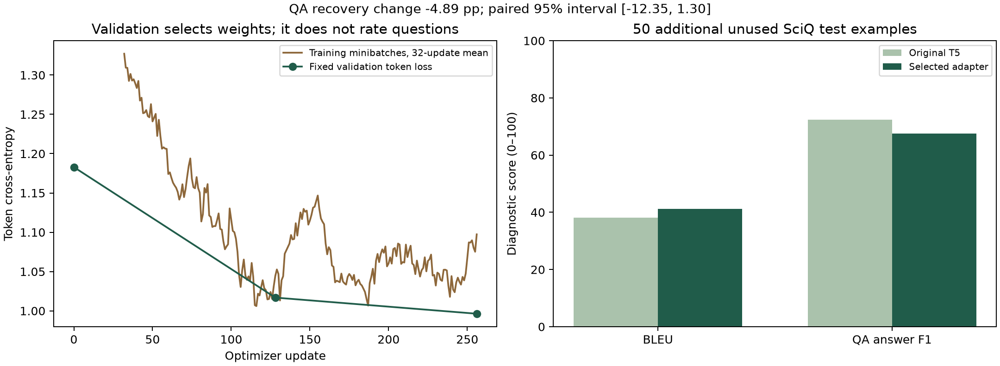

# Generalization audit: unused data and unchanged models

This evaluates a frozen system after fixing a development example. The user's lecture
is not a test set and no model is trained on it. No weights, prompts, candidate rules
or thresholds are changed in response to this audit. See [the frozen protocol](GENERALIZATION_PROTOCOL.md).

## Week 10 connection

Physical slides 7/11 cover dropout and early stopping; slide 19 separates training,
validation and final testing; slides 20/41/42 cover search, error analysis and fair
comparison. The earlier eight-setting grid already varies learning rate, LoRA rank
and dropout and saves validation-selected weights. This new audit checks unused data
instead of treating a lower training/validation loss or a repaired example as proof of generalization.

## Fixed-answer T5 generalization

Fifty additional human-authored SciQ test pairs were excluded from every previous
prepared/evaluated paragraph and reference-question pool. Both models receive identical
passages, exact target answers and beam-4 decoding. The adapter was selected before
this test; its weights and selection are unchanged. Original and adapted results are both retained.

| Model | Inputs | BLEU | chrF++ | ROUGE-L | QA answer F1 |
|---|---:|---:|---:|---:|---:|
| reference_control | 50 | 100.00 | 100.00 | 100.00 | 76.45 |
| original_t5 | 50 | 38.09 | 55.42 | 60.85 | 72.39 |
| selected_t5 | 50 | 41.19 | 56.44 | 59.95 | 67.50 |

Selected minus original QA recovery: **-4.89 percentage points**, paired
paragraph-bootstrap 95% interval **[-12.35, 1.30]**.
BLEU improves while QA recovery falls descriptively; the interval includes zero.
There is no established general question-quality improvement. This does not by
itself diagnose overfitting: sample variation, reference style and training-objective
mismatch also matter. The reference QA control shows that the judge is imperfect.

The training curve is a moving mean over changing minibatches with training-time
dropout; validation is a fixed evaluation pool. Do not treat their exact difference
as a calibrated generalization gap. Lower token loss is not a usefulness rating.

### Source-linked test examples

Purposive examples explaining successes/regressions, not a representative error-rate sample.

- `sciq:test:593`: Regression: the original asks what has the stated goal, matching science. The adapted question asks for the goal of understanding, reversing the relation and no longer requesting the assigned target.
- `sciq:test:24`: Regression on a fragmentary source: the original asks where chemical energy is stored. The adapted output repeats stored-in wording and becomes an unclear cloze.
- `sciq:test:572`: Regression: the original asks what a codon stands for. The adapted output is a declarative sentence about properties of the genetic code, with no question and no match to the amino-acid target.
- `sciq:test:73`: The adapted cloze recovers life cycles more exactly, but its wording is awkward. Higher QA recovery does not by itself establish better fluency or learning value.
- `sciq:test:547`: Improvement: the original asks vaguely what quarks are while the target names their composite particles. The adapted cloze asks what quarks make up, aligning the target protons/neutrons with the source.

## Automatic multilingual transfer

Four previously unused human-authored paragraphs per language were sampled from
pinned SQuAD/NewsQuAD-fr/TyDiQA-GoldP evaluation pools before any inference. Their
paragraphs/reference questions are disjoint from all prior prepared/evaluated material.
Known article titles are also excluded and distinct; French article identity is absent
so article-level isolation cannot be established there. Generic headings and 68-character
line wrapping test layout handling without inventing the factual content.

No human reference question, reference answer or hand-written objective is supplied
to automatic selection. Native drafts and revised questions share the selected targets.
The human reference may ask about a different fact, so reference-overlap scores are
not calculated for this end-to-end arm.

Recorded **12 cases**, **0 execution-error cases**; maximum requested **36 questions**.

| Stage | Returned questions | Conditional QA answer F1 |
|---|---:|---:|
| planned_t5 | 26 | 27.29 |
| classroom_hybrid | 26 | 33.36 |

Coverage and conditional QA averages are not percentages of correct or useful questions.
Omissions and failures stay in the record. Read [every source-linked comparison](../results/generalization_v1/automatic/comparison.html).

- `en:5726ab47f1498d1400e8e6a4` (en): The event question is readable and supported: the source explicitly says the relationship was reinforced when Borte was captured. Only one target is selected. The longer alliance/support statements exceed the whole-statement target budget, so the quiz does not cover the full paragraph.
- `en:57108c95b654c5140001f97a` (en): The three-location answer matches the enumerated congregations. The historic-district question combines its stated status and significance; the naming question uses the explicitly described Huguenot settlement. Questions are supported but targets remain broad and some items ask multiple linked facts.
- `en:57340d124776f419006617bf` (en): The three revised questions ask about consequences for native populations, the departure of Spanish Catholics and the stated road-construction reason for Ohio settlement vulnerability. These match the supplied cause/effect statements and are clearer in focus than the generic first draft. Targets remain longer than minimal answers.
- `en:5728fd206aef05140015494d` (en): The flora question resolves the source antecedent and asks about the stated reduction in pathogen growth risk. The antibiotics item drops the source's possibility wording: What happens should be What can happen, since overgrowth is not stated as inevitable. This is a scope limitation on unseen data. Other long statements are not selected under the target-length budget.
- `fr:2823` (fr): The first question mishandles the idiom Dans le fond and is grammatically unclear; the outline fix does not solve this unseen wording failure. The second asks about the narrative attributed to the law within the source, not independently verified history. The why-question has a source explanation but uses the vague referent ce phenomene. These items still need wording review.
- `fr:2849` (fr): The question asks the stated purpose of the counting stations: supplying the reported figures. It is source-supported, but selects only one narrow fact from a long sentence and leaves the electric-bike explanation and growth comparisons untested. This is limited coverage rather than proof that the paragraph lacks useful material.
- `fr:2969` (fr): The edited question asks for the complete three-part funding allocation, matching the full list rather than a singleton amount. It is more explicit than the T5 draft, but the preceding pronoun Ils still has no antecedent in this isolated paragraph. QA extracts only one amount, illustrating the judge/long-target mismatch.
- `fr:2858` (fr): The revision clarifies the level/status, commission action and emissions comparison requested by three long targets. All are stated in the source; the first is awkwardly phrased and the third asks two linked quantities. The source does not name the incident, so the question remains context-dependent. QA does not recover the full answers.
- `ar:arabic--2076333825012450523-0` (ar): The hybrid retains the supported independence/date and two-main-islands questions. It repairs a draft asking where Samoa island is into a question about the stated location of the capital and airport. Answers are whole sentences instead of minimal spans; the multilingual QA judge scores the location question zero despite the explicit source relation. A Latin proper-name line wrap remains unjoined.
- `ar:arabic--8758125575301076471-0` (ar): The revised Arabic questions repair nonsensical symptom/heading drafts into the stated movement comparison, usual quiescent state and stage after the larva. The third answer is much broader than its question, and the source begins with a fragment. All three ask source-supported facts, but long sentence targets weaken answer focus and QA recovery.
- `ar:arabic-5810637412317400854-0` (ar): No questions are produced from a usable biographical fact because the source paragraph lacks terminal punctuation. The conservative complete-statement rule treats it as ineligible. This is a preprocessing coverage failure, retained as a zero-output case rather than replaced or counted as successful abstention.
- `ar:arabic--2677472451519050021-0` (ar): The three T5 drafts repeat the generic Who are the Arameans question despite different targets. The hybrid distinguishes their language, the stated state-building/agricultural achievements and the naming of their land. These are source-supported repairs, but the second is broad and passive, the third is awkward, and whole-sentence answers contain more than each question requests.

## What the evidence supports

The classroom fix addresses generic layout/answer-scope failures and gives a clearer
choice of T5-only versus Qwen-assisted generation. It is not a topic-specific answer
lookup. The frozen test records show where it transfers and where coverage/wording
still fail. The adapter experiment does not establish that fine-tuning is uniformly better.

Twelve automatic paragraphs and 50 SciQ pairs are limited evidence. Public checkpoints
may have seen these corpora upstream; our split audit cannot rule that out. Semantic
near-duplicates may remain. Human correctness/usefulness ratings are pending. Any
future model change needs validation-based selection and another untouched final test.
