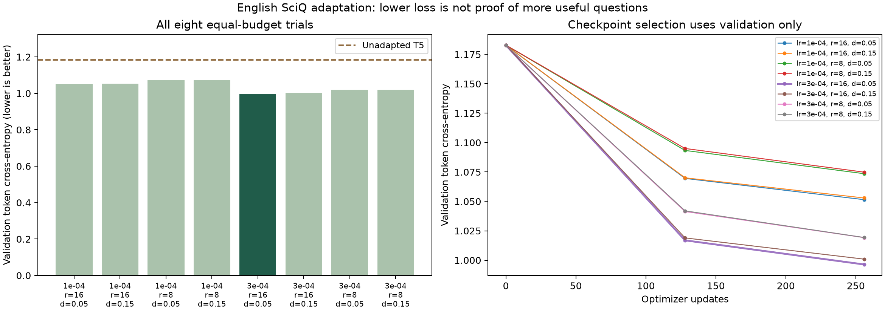

# Educational science T5 training

This experiment changes the English training domain to human-authored science questions and
systematically searches three adapter hyperparameters. It does not train French/Arabic or
establish human-rated usefulness. The separate Qwen planner/editor is inference-only.

Source: [AllenAI SciQ](https://huggingface.co/datasets/allenai/sciq), Welbl, Liu and Gardner (2017),
CC BY-NC 3.0, revision `2c94ad3e1aafab77146f384e23536f97a4849815`. See
[the frozen protocol](SCIENCE_TRAINING_PROTOCOL.md). The interrupted preflight attempt is preserved
in `results/science_training_aborted_v1`; no weights from it enter this study.

## Training and selection

Prepared: 2,048 training / 128 validation / 200 reserved test examples, one per support passage.
Usable token-budget examples: 2,043 train / 126 validation.
Full raw published validation/test support passages and question strings remain protected,
even when an answer annotation is unusable. Exact duplicate support/questions are removed.
Public checkpoint pretraining exposure and semantic near-duplicates cannot be excluded.

All eight trials: seed 42, 256 updates, nominal effective batch 8, FP32 CPU, q/v LoRA,
alpha = 2 * rank, AdamW, 16 warmup updates, validation at steps 0/128/256. Same example order.
An overlong question is excluded, never silently truncated; the input window retains the answer.

| Learning rate | Rank | Dropout | Saved step | Validation loss | Distinct training rows: whole run |
|---:|---:|---:|---:|---:|---:|
| 1e-04 | 16 | 0.05 | 256 | 1.0515 | 2,043 |
| 1e-04 | 16 | 0.15 | 256 | 1.0529 | 2,043 |
| 1e-04 | 8 | 0.05 | 256 | 1.0736 | 2,043 |
| 1e-04 | 8 | 0.15 | 256 | 1.0749 | 2,043 |
| 3e-04 | 16 | 0.05 | 256 | 0.9964 | 2,043 |
| 3e-04 | 16 | 0.15 | 256 | 1.0009 | 2,043 |
| 3e-04 | 8 | 0.05 | 256 | 1.0192 | 2,043 |
| 3e-04 | 8 | 0.15 | 256 | 1.0193 | 2,043 |

Selected `lr3e-04_r16_d0.05` at update 256; validation loss
1.1829 → 0.9964.
Selection includes the unadapted step-zero model. One seed and one budget per setting do not
establish a globally optimal configuration or isolate each hyperparameter's causal effect.



## Generation after selection

Original and selected T5 receive identical exact answers/passages and beam-4 decoding.
Question/answer pairs differ from the original project tests. These are public published
SciQ splits, not guaranteed-unseen checkpoint pretraining data. No test result reselects weights.

| Split / method | Inputs | BLEU | chrF++ | ROUGE-L | QA answer F1 |
|---|---:|---:|---:|---:|---:|
| dev / reference_control | 64 | 100.00 | 100.00 | 100.00 | 75.82 |
| dev / original_t5 | 64 | 26.31 | 46.96 | 54.12 | 61.38 |
| dev / selected_t5 | 64 | 44.30 | 60.86 | 64.39 | 69.43 |

dev: selected minus original QA answer F1 +8.05 percentage points;
paired paragraph-bootstrap 95% interval [0.62, 15.05].

| Split / method | Inputs | BLEU | chrF++ | ROUGE-L | QA answer F1 |
|---|---:|---:|---:|---:|---:|
| test / reference_control | 200 | 100.00 | 100.00 | 100.00 | 76.50 |
| test / original_t5 | 200 | 31.83 | 50.90 | 59.83 | 72.63 |
| test / selected_t5 | 200 | 42.11 | 58.69 | 64.15 | 74.11 |

test: selected minus original QA answer F1 +1.48 percentage points;
paired paragraph-bootstrap 95% interval [-2.34, 5.60].

## Source-linked development inspection

Purposive source-linked development inspections, not human ratings, a representative error sample, or an estimate of educational benefit.

- `sciq:validation:240`: The original question ambiguously asks which tissue animals have. The adapted question supplies muscle tissue and asks for the other type, focusing the intended nervous-tissue answer.
- `sciq:validation:407`: The original asks vaguely what adding salt does. The adapted question explicitly asks about the boiling point, matching the relation and intended direction-of-change answer in the source.
- `sciq:validation:521`: The original asks for a drawback while the target is a reproduction type. The adapted question asks which type produces identical offspring, aligning the requested answer with the source.
- `sciq:validation:290`: Regression: the adapted output is a copied declarative sentence with a question mark. It does not ask for magnitude, the intended target. The original wording was also malformed.
- `sciq:validation:471`: The adapted output copies a long source sentence and its Primary Vesicles heading. Higher QA agreement does not repair the awkward wording or establish better learning value.
- `sciq:validation:415`: Regression: the adapted output ends with 'an what?' and copies a long component list. The human reference also contains a visible '8each' artifact; dataset authorship does not guarantee clean target wording.
- `sciq:validation:35`: The original incorrectly asks about helium. The adapted question asks about noble gases generally but omits the source's explicit helium exception. Partial QA agreement does not establish faithful scope.

QA F1 measures answer recovery, not question accuracy or educational value. Reference controls
show the checker's performance on human questions from this domain. Overlap metrics depend on
one reference wording. Inspect `results/science_evaluation_dev/comparison.html` for every saved
development example; the review template is intentionally empty. Human ratings are pending.

## Reproduce on your computer

```powershell
python -m scripts.prepare_science_data
python -m scripts.train_science_grid --output outputs/science_reproduction --adapters outputs/science_adapters
python -m scripts.evaluate_science --split dev --training-dir outputs/science_reproduction --output outputs/science_eval_dev
python -m scripts.evaluate_science --split test --training-dir outputs/science_reproduction --output outputs/science_eval_test
python -m scripts.build_science_report --training-dir outputs/science_reproduction --evaluation-prefix outputs/science_eval --output outputs/science_report.md
```

Do not run a second training process concurrently. Completed compatible trials are reused;
mid-trial optimizer resume is not implemented. Preserve an interrupted adapter rather than
silently overwrite it. Weights and exact source snapshots accompany all completed trials.

In the app, enable **Use adapted English generator**, then choose **Educational science**
under **English adaptation data**. It is optional; original and general-reading adapters remain
available. Compare actual questions rather than assume that the validation winner is best for
every subject or learning goal.
